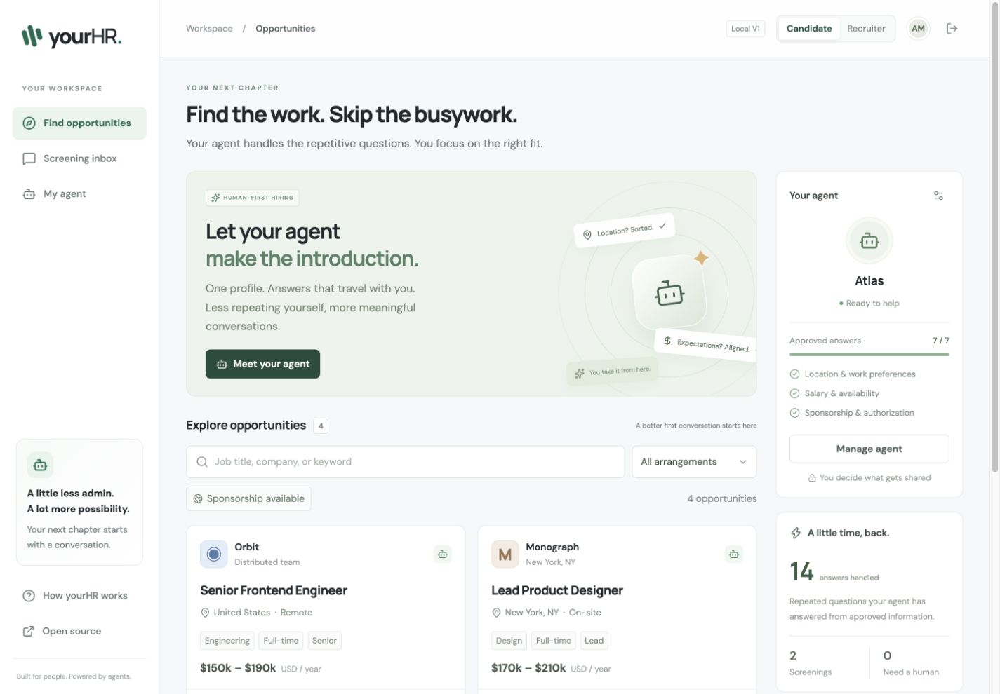

# yourHR

**Less paperwork. More possibility.** A local-first job board where candidate and recruiter agents handle repetitive logistics questions, and people handle the meaningful conversations.

Candidates answer the basics once: location, work authorization, visa sponsorship, relocation, work arrangement, salary expectations, and availability. Recruiters post requirements and let their agent ask the candidate’s agent. Private facts and new custom questions go back to the candidate for approval.



## Public trial

**[Try yourHR online →](https://yourhr-beta.netlify.app/)** — free, public, and no signup required.

The public version now has an isolated, no-signup browser demo for each visitor. Try candidate and recruiter screening, edit approved answers, post sample jobs, and reset your sandbox. The hosted demo makes no paid AI calls and does not contact real employers.

The shared-account Supabase integration is included but is **not activated until the database and verified email delivery are configured**. See [public beta deployment](docs/public-beta.md) for the exact live scope, free-host setup, and remaining backend activation steps.

```sh
npm ci
npm run build:trial
npm run preview:trial
```

## Run locally

Requires **Node.js 24 or newer** and npm. SQLite is built into Node; no database service is needed.

```sh
git clone https://github.com/Jameslovecs/yourHR.git
cd yourHR
npm ci
npm run dev
```

Open **http://127.0.0.1:3000**. Everything works without an API key. The first request initializes `data/yourhr.sqlite` with fictional demo accounts and four fictional job listings.

For an optimized local build:

```sh
npm run build
npm start
```

Both commands bind to loopback, keeping this local prototype off your network by default. Run only one server on port 3000 at a time. Use `npm run dev -- --port 3001` if needed.

## Try the full workflow in two minutes

1. Click **Try candidate demo**. Alex Morgan’s agent, Atlas, has seven approved logistics answers.
2. Open **Senior Product Designer at Forma** and select **Let my agent screen**.
3. Seven logistics answers are shared automatically. The custom product-design question waits for Alex.
4. Write a sample answer and select **Approve & share answer**. Optionally approve reuse for that exact question.
5. Switch to **Recruiter** in the top bar. Open **Screening inbox** to see the same results and conversation. The custom answer remains marked for human review.
6. In **Candidate directory**, select a role and click **Connect our agents** to try recruiter-initiated screening.
7. Visit **My agent** in the candidate workspace. Turn off auto-sharing for a fact, save, then start a screening for a different job: that answer now waits for approval.

The UI demo keeps state in each browser; separate visitors do not share it. The legacy local API demo accounts remain shared inside the local SQLite installation. The role switch deliberately signs into those demo accounts; it is not impersonation access to real accounts. To test separate users, sign out and **Create account** as a candidate or recruiter. New candidate profiles are private and undiscoverable by default.

## What works

- Local account registration and login for candidates and recruiters.
- Searchable job board, work-arrangement and sponsorship filters, and role details.
- Recruiter job posting with salary range, requirements, and up to five custom questions.
- Named built-in agents for each side; pause candidate agents or opt into recruiter discovery.
- Per-field auto-sharing controls, with server-side enforcement.
- Candidate-initiated screening and opt-in recruiter-initiated screening.
- Persistent checks, agent transcript, and role-scoped inboxes.
- One-screening-per-candidate/job idempotency.
- Candidate approval of missing/private answers; optional reuse across future screenings.
- Exact-question reuse of approved custom answers, always flagged for human review.
- Optional AI-written recap, with a deterministic fallback.
- Responsive desktop and mobile layouts.

## What “agent” means here

V1 uses **structured, deterministic agents**, not unrestricted autonomous LLMs or external agent connections. The recruiter agent asks seven known questions plus the job’s custom questions. The candidate agent can only answer using approved facts or exact approved reusable answers. A deterministic comparison produces `aligned`, `review`, or `pending` checks.

The optional language model writes a recap only. It cannot change facts, screening statuses, permissions, or hiring outcomes. No candidate is automatically accepted or rejected, and the application does not send email or messages outside the local app.

### Optional OpenAI recap

```sh
cp .env.example .env.local
```

Set `OPENAI_API_KEY` in `.env.local`, optionally choose `OPENAI_MODEL`, then restart the server. The key stays server-side. **Shared screening answers** are sent to the OpenAI Responses API for this optional recap with `store: false`; unshared profile facts are excluded. Do not enable this if you do not want approved answers sent to that service. API usage may incur charges. `store: false` is not a guarantee of zero provider retention.

The default model is `gpt-4.1-mini`. If the request fails or times out, all structured screening results remain available. The UI labels AI recaps and fallback behavior. No external AI call was needed to test the core workflow.

Reference: [OpenAI Responses API](https://developers.openai.com/api/reference/typescript/resources/responses/methods/create).

## Architecture

- **React, TypeScript, Vite for the hosted static trial; Next.js App Router for local development** for the application.
- **Node `node:sqlite`** with WAL mode for local persistence.
- **Zod** for server-side validation.
- **scrypt** password hashing, opaque server-side sessions, HTTP-only SameSite cookies.
- **Lucide** icons and CSS; Google Fonts are optional visual enhancements, with system-font fallbacks.

```text
app/
  page.tsx                    App entry
  api/[...path]/route.ts       Authentication, profiles, jobs, screening, approval
  globals.css                 Responsive visual system
components/workspace.tsx       Candidate and recruiter interfaces
lib/
  types.ts                    Shared domain types
  db.ts                       Schema, persistence, fictional demo data
  screening.ts                Approval-aware agent protocol and comparisons
  validation.ts               Request validation
  summary.ts                  Optional OpenAI recap, timeout and fallback
tests/
  screening.test.ts           Comparisons, privacy, missing answers, custom reuse
  api.test.ts                 Accounts, authorization, consent, posting, persistence
```

Read [the architecture notes](docs/architecture.md) for API and data-flow details.

## Development and checks

```sh
npm test
npm run build
npm run typecheck
```

Tests use an isolated temporary database and do not change local demo data. The API workflow test exercises real route handlers, sessions, roles, and SQLite. The production build also checks TypeScript. CI runs tests and the build on Node 24.

Dependencies are pinned and the npm lockfile is committed. SQLite files, local settings, secrets, and dependencies are excluded from Git. To start over, stop the server and move your `data` directory to a backup location; the next launch will create fresh demo data.

## V1 boundaries

This is a **working local prototype**, not a production hiring service.

- Accounts have no email verification, password recovery, MFA, or employer verification. There is no abuse throttling, full auditing, retention/deletion UI, or production account administration.
- Demo accounts are intentionally accessible. `DISABLE_DEMO=true` disables the demo login endpoint; production also needs demo-data removal and a real identity system.
- Cookies default to HTTP for loopback development. A future HTTPS deployment should set `SECURE_COOKIES=true` and add production hardening; changing that flag alone does not make this app production-ready.
- Screening is scoped to US work authorization and USD annual base compensation. Remote roles assume eligible US-based work; the app does not verify country, state eligibility, visa details, or legal eligibility.
- Non-remote locations are compared as normalized exact strings, not geocoded commute regions. Different locations are discussion items, even if relocation is allowed. Salary comparison checks the candidate’s minimum against the role’s ceiling; it does not negotiate total compensation.
- Existing conversations are snapshots. Changing profile permissions affects future sharing, not facts already shared. Starting the same job again opens its existing screening.
- Custom answers require human interpretation. “Logistics aligned” does not assess skill, qualifications, or mutual cultural fit.
- External agent registration, resumes, skill matching, interview scheduling, direct messaging, notifications, and hosted multi-tenant deployment are future work.

## Contributing

Issues and pull requests are welcome. Keep permissions and human control explicit. Include a regression test for any change to screening rules, role authorization, or data sharing. Use fictional data in examples and screenshots. Never commit personal candidate information or credentials.

Potential next steps: verified production identity, an external agent protocol, richer geography/currency support, interview handoff, and candidate-controlled reusable answers for additional question types.

## License

MIT. See [LICENSE](LICENSE).
